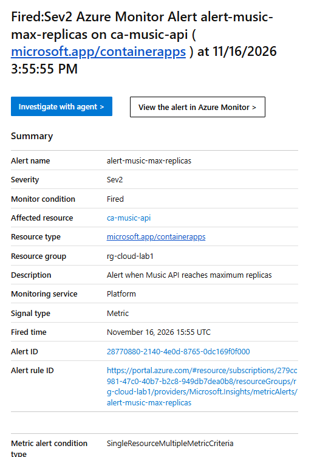
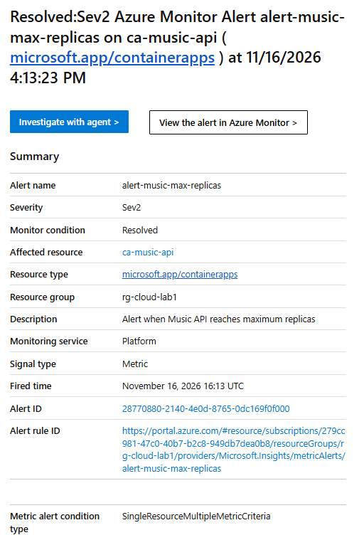

# Сповіщення

Для контролю надмірного навантаження на REST API використовується Azure Monitor.

Сповіщення налаштовані за допомогою Terraform. При досягненні максимального навантаження система надсилає лист на електронну пошту. Після повернення до нормального стану надходить другий лист.

## Обрана умова

Для спрацювання сповіщення обрано досягнення максимальної кількості екземплярів Azure Container Apps.

Параметри:

- Метрика: Replicas
- Максимальна кількість реплік: 3
- Умова: Replicas > 2
- Період перевірки: 1 хвилина
- Рівень серйозності: 2
- Автоматичне закриття тривоги: увімкнено

Коли кількість реплік збільшується до 3, Azure Monitor створює сповіщення про перевищення порогу.

Коли навантаження зменшується і кількість реплік повертається до нормального значення, тривога автоматично закривається.

## Обґрунтування

Обрано умову досягнення максимальної кількості реплік, оскільки вона дозволяє визначити, коли система використовує всі доступні екземпляри.

У нашому випадку максимальна кількість реплік становить 3.

Якщо навантаження продовжить зростати, система не зможе додати більше реплік через встановлене обмеження.

Тому досягнення максимального значення є підставою для надсилання сповіщення.

## Результати тестування

Для перевірки було використано навантажувальний тест k6 із 20 віртуальними користувачами.

Під час тестування кількість реплік збільшувалася з 1 до 3.

Після завершення навантаження кількість реплік поступово повернулася до 1.

Було отримано два сповіщення на електронну пошту.

Зафіксовано такі моменти:

- 17:56:57 — початок сталого навантаження.
- 17:59 — отримано перший лист Fired.
- 18:15 — отримано другий лист Resolved.

Таким чином, система правильно визначила досягнення максимальної кількості реплік і подальше повернення до нормального стану.

## Перший лист — Fired

Перший лист надійшов о 17:59.

Він повідомляє про те, що кількість реплік досягла встановленого максимального значення.

## Другий лист — Resolved

Другий лист надійшов о 18:15.

Він повідомляє про те, що навантаження зменшилося і система повернулася до нормального стану.

## Час реакції

Початок сталого навантаження: 17:56:57.

Отримання першого листа: приблизно 17:59.

Отже, сповіщення надійшло приблизно через 2 хвилини після початку сталого навантаження.

Затримка виникає через необхідність зібрати метрики, перевірити умову спрацювання та доставити повідомлення на електронну пошту.

## Чому другий лист надійшов пізніше

Між першим і другим листами минуло приблизно 16 хвилин.

Це пояснюється тим, що навантаження не завершується одразу після отримання першого сповіщення.

Після завершення тесту Azure Container Apps поступово зменшує кількість реплік.

Також Azure Monitor повинен переконатися, що умова тривоги більше не виконується.

Тому лист Resolved надходить пізніше, ніж фактичне зменшення навантаження.

## Оцінка часу реакції

Час реакції приблизно 2 хвилини можна вважати прийнятним для навчального REST API.

Однак для реального сервісу з великою кількістю користувачів така реакція не завжди буде достатньо швидкою.

Досягнення максимальної кількості реплік означає, що можливості подальшого масштабування вже обмежені.

Тому для реальної системи доцільно додатково контролювати латентність і кількість помилок HTTP.