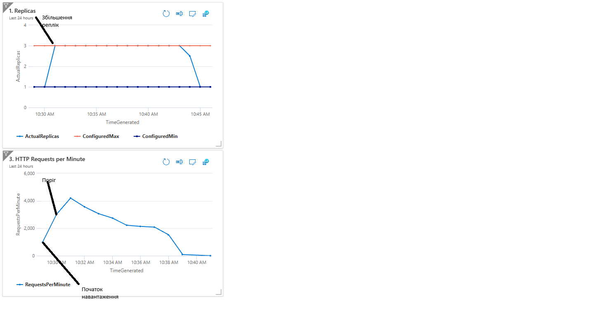
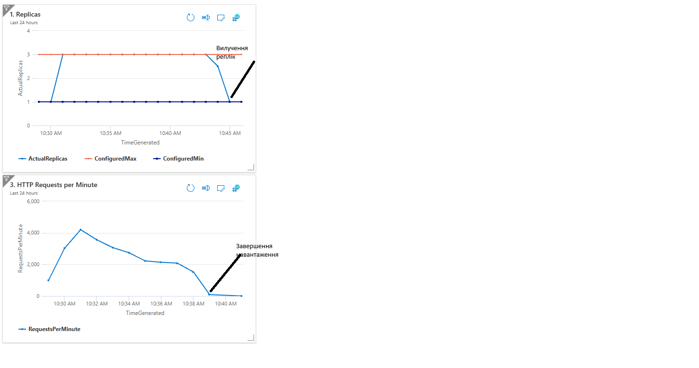
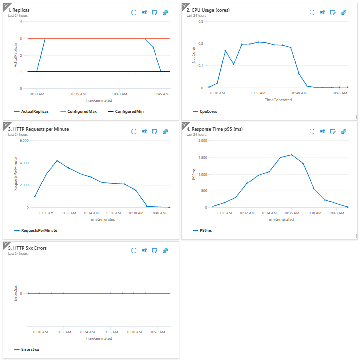

# Автоматичне масштабування

Для масштабування REST API використовується Azure Container Apps.

## Параметри

- Мінімальна кількість екземплярів: 1
- Максимальна кількість екземплярів: 3
- Тип масштабування: HTTP
- Цільове значення: 10 одночасних запитів
- Cooldown: 300 секунд

## Обґрунтування

Мінімум 1 екземпляр забезпечує постійну доступність API.

Максимум 3 екземпляри дозволяє обробляти більше запитів
без надмірного використання ресурсів Azure.

Поріг 10 одночасних запитів обрано для перевірки
масштабування під час навантажувального тестування.

## Cooldown

Cooldown — це період очікування перед зменшенням
кількості екземплярів після спаду навантаження.

Встановлено 300 секунд.

Якщо встановити cooldown = 0, екземпляри можуть
занадто часто створюватися та видалятися при
коливаннях навантаження. Це може призвести до
нестабільної роботи та додаткових витрат.

## Результати масштабування

За допомогою Azure Monitor було перевірено зміну кількості реплік під час навантаження.

На графіках спостерігалися такі моменти:

10:29 — початок навантаження. Кількість HTTP-запитів почала збільшуватися. Спочатку працювала одна репліка.

10:30–10:31 — приблизний момент досягнення порогу масштабування. Навантаження швидко зростало. Точний момент перетину порогу 10 одночасних запитів на графіку запитів за хвилину не відображається.

10:31 — поява додаткових реплік. Кількість активних реплік збільшилася з 1 до 3.

10:39–10:40 — завершення навантаження. Кількість HTTP-запитів зменшилася майже до нуля.

10:44–10:45 — вилучення додаткових реплік. Кількість реплік поступово зменшилася до 1.

## Масштабування вгору

На першому скриншоті показано збільшення кількості HTTP-запитів та появу додаткових реплік.

Спочатку працювала одна репліка. Після збільшення навантаження Azure автоматично створив додаткові екземпляри, і їхня кількість зросла до 3.

## Масштабування вниз

На другому скриншоті показано зменшення кількості реплік після завершення навантаження.

Приблизно о 10:40 кількість запитів майже досягла нуля, проте додаткові репліки залишалися активними ще деякий час.

Близько 10:44–10:45 кількість реплік повернулася до 1.

## Пояснення затримки масштабування

Між досягненням порогу та появою додаткової репліки проходить певний час.

Це пов'язано з тим, що Azure спочатку збирає та перевіряє метрики навантаження. Після цього система приймає рішення про масштабування. Також потрібен час для створення та запуску нового контейнера.

Зменшення кількості реплік відбувається значно пізніше за падіння навантаження.

Це пояснюється тим, що система не видаляє додаткові репліки відразу. Вона очікує стабілізації навантаження, щоб уникнути частого масштабування вгору та вниз.

Для зменшення кількості реплік зазвичай використовується п'ятихвилинне вікно стабілізації.

У нашому випадку навантаження завершилося приблизно о 10:40, а повернення до однієї репліки відбулося близько 10:45.

## Загальний вигляд панелі моніторингу

Для спостереження за роботою застосунку створено панель Azure Monitor Dashboard за допомогою Terraform.

На панелі відображаються п'ять основних графіків:

Replicas — кількість активних реплік.

CPU Usage — використання процесора.

HTTP Requests per Minute — кількість HTTP-запитів за хвилину.

Response Time p95 — затримка відповіді.

HTTP 5xx Errors — кількість серверних помилок.

Під час навантажувального тестування використання процесора зростало приблизно до 0,21 ядра, а максимальна кількість запитів становила близько 4200 за хвилину.

Затримка відповіді також збільшувалася під час навантаження.

На графіку HTTP 5xx Errors кількість помилок залишалася нульовою.

